<p align="center">
  
</p>

<h1 align="center">MiaCode</h1>

<p align="center">
  <a href="https://miacode.net/en/"></a>
  <a href="https://github.com/Team-MiaCode/MiaCode/releases/latest"></a>
  <a href="https://github.com/Team-MiaCode/MiaCode/actions/workflows/package.yml?query=branch%3Adev"></a>
  <a href="https://github.com/Team-MiaCode/MiaCode/stargazers"></a>
  <a href="LICENSE"></a>
</p>

<p align="center">
  <a href="README.md">中文</a> | <a href="README_EN.md">English</a>
</p>

MiaCode is a maimai chart authoring tool built with Qt 6 / C++ / QML, with editing, live preview, syntax and Muri checks, video export, and cover creation for Windows, Apple Silicon macOS, and Linux.

<table align="center" width="100%">
  <tr>
    <td align="center" width="50%">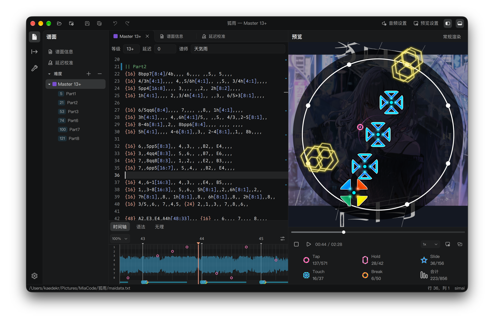</td>
    <td align="center" width="50%">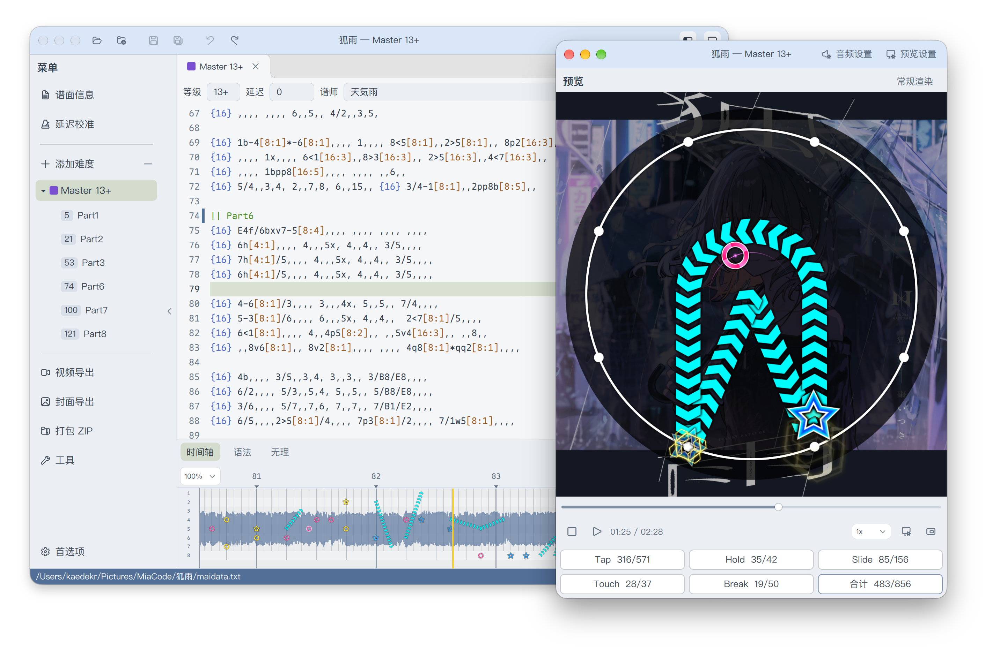</td>
  </tr>
  <tr>
    <td align="center">Dark theme</td>
    <td align="center">Light theme</td>
  </tr>
</table>

## Quick Start

### Download

<p align="center">
  <a href="https://miacode.net/en/download.html"></a>
  <a href="https://github.com/Team-MiaCode/MiaCode/releases">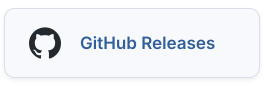</a>
  <a href="https://github.com/Team-MiaCode/MiaCode/actions/workflows/package.yml?query=branch%3Adev"></a>
</p>

Packages are available for Windows and macOS.

Linux users can [build from source](#build).

- **Windows**: Double-click `MiaCode.exe` in the extracted folder.
- **macOS**: Double-click `MiaCode.app`, or drag it into Applications. If macOS displays a security prompt, open Terminal in the extracted folder and run `xattr -dr com.apple.quarantine "MiaCode.app"`, then launch the app.

See the [Quick Start](https://miacode.net/en/miacode/quick-start) for usage instructions.

## Features

### Highlights

- Adjustable panel widths, with interchangeable editor and preview positions.

- Dark and light themes, with Chinese, English, and Japanese interfaces and automatic system matching.

- Preview updates as you type. Scrub through the chart at any time, including while paused.

- Difficulty tabs, a source overview ruler, and customizable completion candidates.

- Detachable preview windows and interface zoom.

### Syntax and Muri Checks

<table align="center" width="100%">
  <tr>
    <td align="center" width="50%">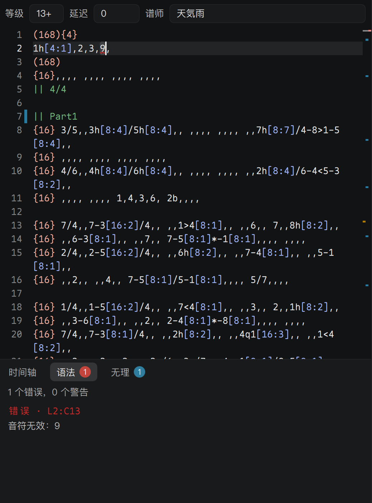</td>
    <td align="center" width="50%">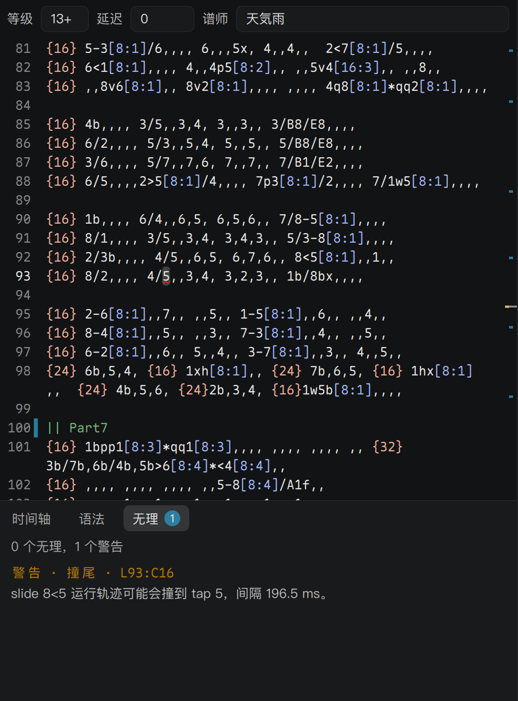</td>
  </tr>
  <tr>
    <td align="center">Syntax check</td>
    <td align="center">Muri detection</td>
  </tr>
</table>

Check chart syntax and detect Muri (physically unplayable patterns), with navigation to the relevant lines.

### Video and Cover Export

#### Export

<p align="center">
  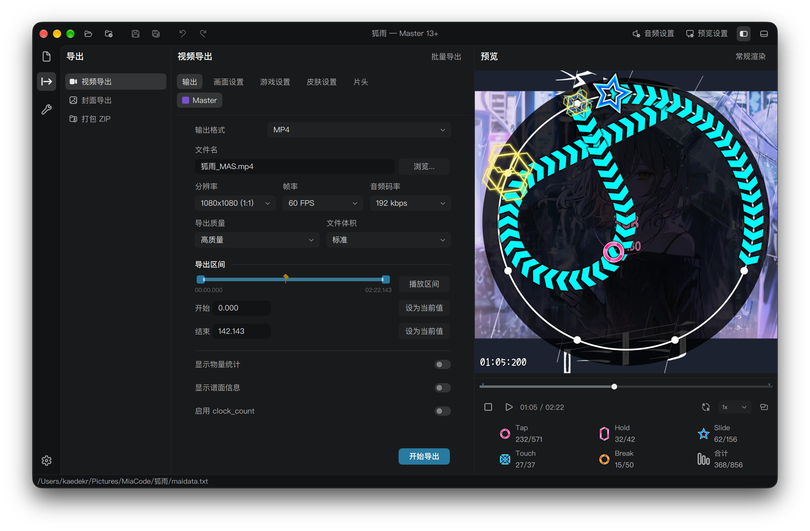
</p>

Export chart preview videos with an intro and full-background PV.

Set a custom export range, or select a section in the editor and use it as the export range.

Supports range playback, MP4 / WAV / MP4 + WAV output, and batch export of videos with preset covers.

#### Covers

<p align="center">
  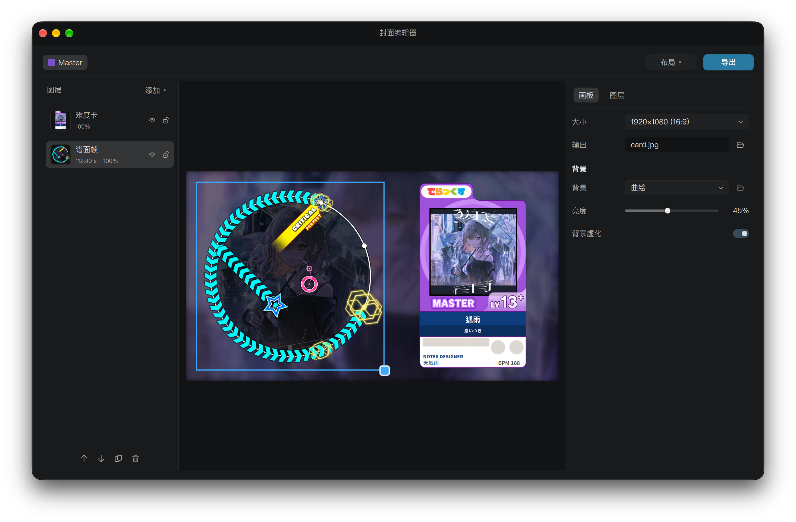
</p>

Create covers for publishing chart videos.

Customize fonts, backgrounds, and other visual elements, and overlay chart frame screenshots to showcase patterns.

Supports difficulty card, chart frame, image, and text layers, with reusable layout presets.

### Net Chart Download and Upload

<p align="center">
  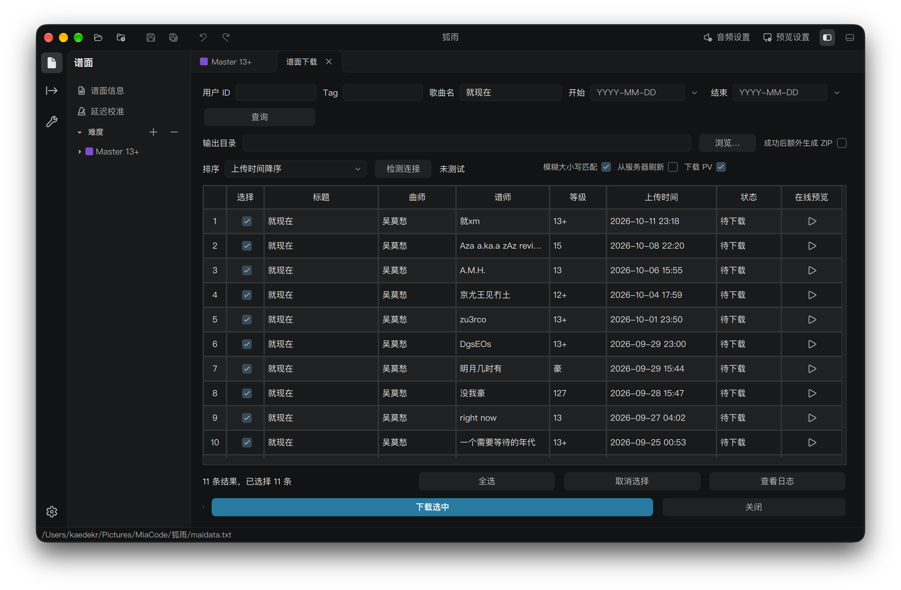
</p>

Filter Majdata Net charts by user ID, tag, song title, and upload date. Select charts to download in batches to a chosen folder, with optional ZIP archives.

Supports online preview, PV downloads, and batch upload of local charts after signing in to Majdata Net.

### More Tools

<table align="center" width="100%">
  <tr>
    <td align="center" width="50%">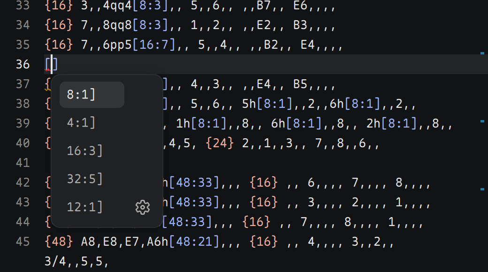</td>
    <td align="center" width="50%">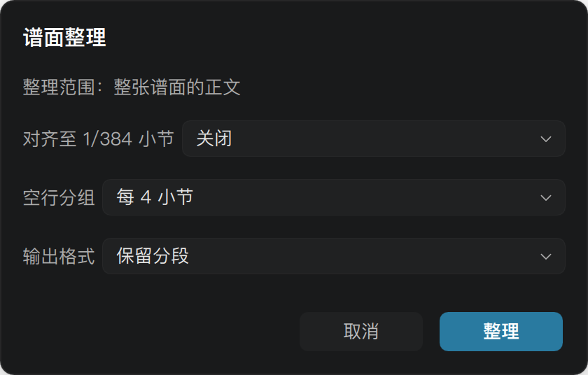</td>
  </tr>
  <tr>
    <td align="center">Note duration completion</td>
    <td align="center">Chart formatting</td>
  </tr>
  <tr>
    <td align="center" colspan="2">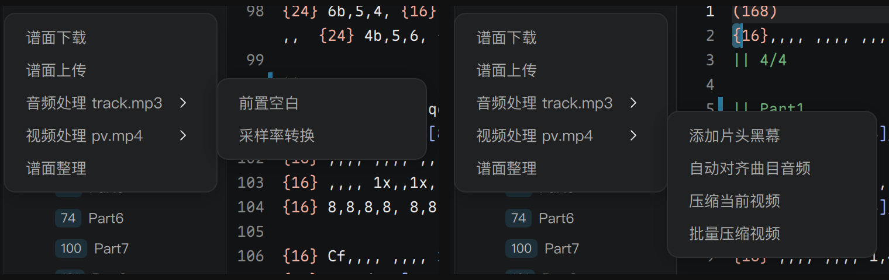</td>
  </tr>
  <tr>
    <td align="center" colspan="2">Audio and video tools</td>
  </tr>
  <tr>
    <td align="center" colspan="2">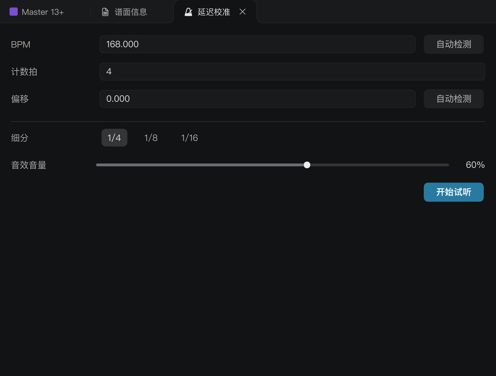</td>
  </tr>
  <tr>
    <td align="center" colspan="2">BPM and latency detection</td>
  </tr>
</table>

- Custom backgrounds

- Disable IME input or convert full-width characters
- Bookmark navigation
- Quick Touch note authoring
- Drag in audio to create a chart
- Display the beat count of a selection
- Reset tap note positions to lane 1
- Note duration completion
- One-click chart formatting

- Audio and video tools
- BPM and latency detection

<details>
<summary><h2 id="build">Build</h2></summary>

### Requirements

- CMake 3.21+
- C++20 compiler
- Qt 6.10+ with Qt Quick, Quick Controls 2, Multimedia, Shader Tools, Linguist Tools, and Gui and Multimedia private development headers

See [scripts/README_EN.md](scripts/README_EN.md) for packaging details.

### Windows

Install the following build tools:

- Visual Studio 2022 or Build Tools 2022 with the Desktop development with C++ workload
- CMake 3.21+
- Python 3 with pip

Run the script to install Qt, prepare dependencies, build, and package the application:

```powershell
powershell -ExecutionPolicy Bypass -File .\scripts\build\build-win.ps1 -Toolchain msvc -BuildJobs 4
```

On an ARM64 host, use `-Toolchain msvc-arm64` with a separate build directory; see [scripts/README_EN.md](scripts/README_EN.md).

### macOS

Use an Apple Silicon Mac running macOS 13 or later. Install Xcode Command Line Tools, then install CMake and Python 3 with [Homebrew](https://brew.sh/):

```bash
xcode-select --install
brew install cmake python
```

Install Qt 6.11.1 with Multimedia and Shader Tools, prepare the preview SDK and export FFmpeg, then build and package:

```bash
python3 -m pip install aqtinstall
python3 -m aqt install-qt mac desktop 6.11.1 clang_64 --outputdir .qt \
  --modules qtmultimedia qtshadertools
bash scripts/ffmpeg/ensure-macos-ffmpeg-dev.sh
bash scripts/ffmpeg/ensure-macos-ffmpeg.sh
bash scripts/build/build-macos-local.sh
```

Set `QT_ROOT` to reuse an existing Qt installation. The local script reuses dependencies and writes packages to `dist/`.

### Linux (Advanced Users)

Linux builds require manual setup. Install CMake 3.21+, a C++20 compiler, pkg-config, and Qt 6.10+ (including Qt Quick, Quick Controls 2, Multimedia, the Gui and Multimedia private development headers, Shader Tools, and Linguist Tools), along with development libraries for FFmpeg, VA-API, DRM, and OpenGL / EGL. The FFmpeg development libraries must include `libavfilter`, `libavcodec`, `libavformat`, `libavutil`, `libswresample`, and `libswscale`.

Run the following commands from the repository root, replacing `[/path/to/Qt/6.x/gcc_64]` with your Qt installation directory:

```bash
cmake -S . -B build -DCMAKE_BUILD_TYPE=Release \
  -DCMAKE_PREFIX_PATH="[/path/to/Qt/6.x/gcc_64]"
cmake --build build --target MiaCode --parallel 4
./build/bin/MiaCode
```

Audio/video processing and export use a separate `ffmpeg` executable. Install FFmpeg with H.264 / AAC encoding support.

</details>

<details>
<summary><h2 id="repository-layout">Repository Layout</h2></summary>

- [src](src): application source
- [assets](assets): runtime assets and generated data
- [resources](resources): Qt resource collections
- [scripts](scripts): build and maintenance scripts
- [third_party](third_party): third-party dependencies
- [docs](docs): documentation
- [samples](samples): sample resources for specification tests

</details>

<details>
<summary><h2 id="license">License</h2></summary>

Project code is licensed under [GPLv3](LICENSE). Third-party licenses are listed in [THIRD_PARTY_NOTICES.md](THIRD_PARTY_NOTICES.md).

</details>

## Maintenance and Feedback

Browse [existing issues](https://github.com/Team-MiaCode/MiaCode/issues), or share errors and unexpected behavior there.

When opening an [issue](https://github.com/Team-MiaCode/MiaCode/issues), include the state of the error or unexpected behavior, the preceding actions, reproduction steps, MiaCode version, environment, observed behavior, and relevant information.

Logs and diagnostic information are important to us. See the [debugging guide](docs/ops/DEBUG_INDEX.md) for collection details.

Code and documentation improvements are welcome through pull requests. Larger feature or architecture changes can be discussed in an issue first.

## Acknowledgements

Thanks to [Minepig/MaiMuriDX](https://github.com/Minepig/MaiMuriDX) for the Muri detection reference.

Thanks to [gfdfdxc/maimai-transition](https://github.com/gfdfdxc/maimai-transition) for the intro animation reference.

Thanks to [Majdata Net](https://majdata.net/) for the community chart platform.

Thanks to [MaiViewer](https://www.maiviewer.net/) for the official chart transcription download site.

Special thanks to hitomi for drawing the MiaCode logo free of charge.

Thanks to everyone who offered suggestions, reproduced issues, and helped with debugging during internal testing; see [ACKNOWLEDGEMENTS.md](ACKNOWLEDGEMENTS.md).

## Community

Join the official MiaCode QQ group: 1095435375

<p align="center">
  
</p>
